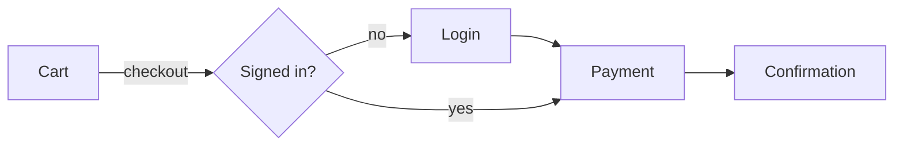
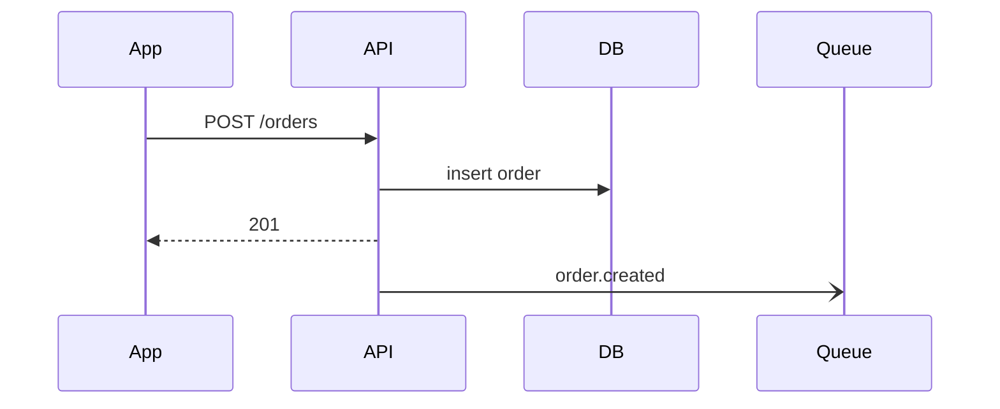
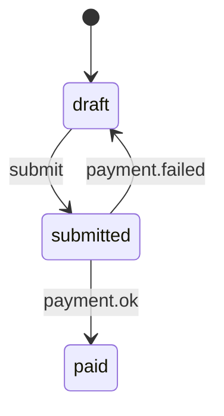
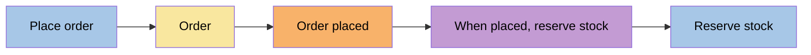
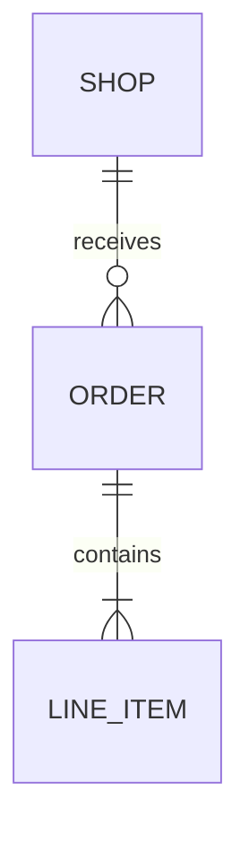
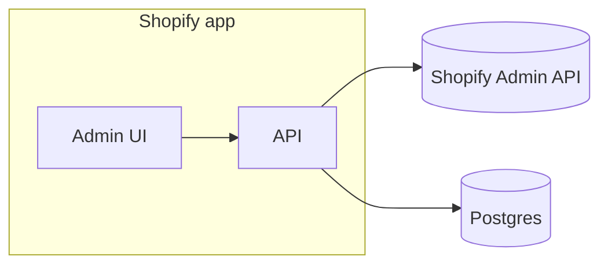
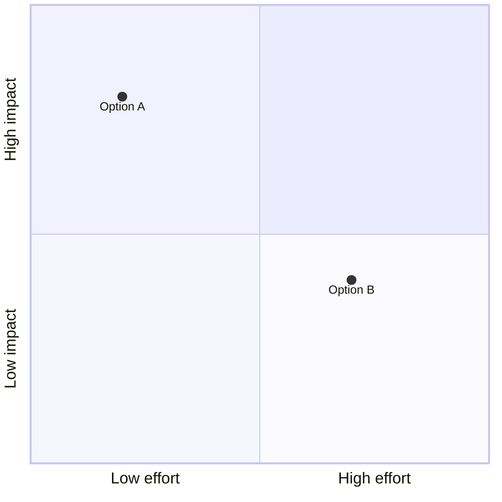
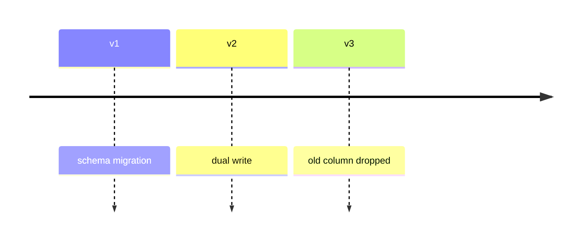

# Visuals by question

Load when a reply or doc carries structure, flow, or numbers. Pick by the reader's question, not by what looks rich; another visual is fine when it answers better. Two sentences that do the job beat any diagram.

## Where it renders

| Medium                     | Renders                                     | Falls back to                        |
| -------------------------- | ------------------------------------------- | ------------------------------------ |
| GitHub (README, PR, issue) | Mermaid, tables, `diff`, `<details>`        | none needed                          |
| npm README, terminal, chat | tables, `text` blocks, unicode bars, `diff` | Mermaid shows as source: use `text`  |
| JSDoc                      | `@example`, short `text` sketch             | no diagrams; link the doc page       |
| HTML artifact or file      | anything, interactive                       | link it, and keep a markdown summary |

## Catalog

| Reader's question                               | Visual                                   | Snippet |
| ----------------------------------------------- | ---------------------------------------- | ------- |
| what does the user do, step by step             | user flow                                | A       |
| who calls whom, in which order                  | `sequenceDiagram`                        | B       |
| which states, which transitions                 | `stateDiagram-v2`                        | C       |
| which business events, commands, aggregates     | event storming                           | D       |
| what shape does the data have                   | `erDiagram`                              | E       |
| which systems, which boundaries                 | context map (`flowchart` + `subgraph`)   | F       |
| where does the time go                          | flamegraph, as a file plus a text icicle | G       |
| how does a volume split or flow                 | `sankey-beta`, `pie`, unicode bars       | H       |
| which option, on two axes                       | `quadrantChart`, or a table              | I       |
| what ships when                                 | `timeline`, `gantt`                      | J       |
| how do options compare on the same fields       | table                                    |         |
| status across many items                        | table with ✅ ❌ ⚠️                      |         |
| what changed                                    | `diff`, or the real command and output   |         |
| what owns what, what lives where                | tree in a `text` block                   |         |
| which decisions are open, which depend on which | decision tree in a `text` block          |         |

## Snippets

Shapes, not data: every label and number comes from the real system.

**A. User flow.** Screens or actions as nodes, the user's choice on the edge.



**B. Sequence.** One lifeline per process or service; note the failure path.



**C. States.**



**D. Event storming.** Keep the conventional colors so readers recognize the grammar: command blue, event orange, aggregate yellow, policy purple.



**E. Data shape.**



**F. Context map.** One `subgraph` per deployable or ownership boundary.



**G. Flamegraph.** Link the real profile (SVG, HTML, speedscope) and add a text icicle of the hot paths in markdown, so the finding survives where the file doesn't open. Width is the share of total time, children indent under their caller, and `◀` marks what the reader should look at.

```text
total: <measured> ms, <profiler>, <run>
handleRequest           ████████████████████ 100%
├─ parseBody            ██░░░░░░░░░░░░░░░░░░  <n>%
└─ loadOrders           ███████████████░░░░░  <n>%
   ├─ db.query          ████████████░░░░░░░░  <n>%  ◀ N+1: one query per order
   └─ serialize         ██░░░░░░░░░░░░░░░░░░  <n>%
```

**H. Volumes.** `sankey-beta` for flows between stages, `pie` for one split, unicode bars where Mermaid doesn't render.

```text
checkout started  ████████████████████ 100%
payment shown     ██████████████░░░░░░  <n>%
paid              ███████████░░░░░░░░░  <n>%
```

**I. Two axes.**



**J. Over time.**


